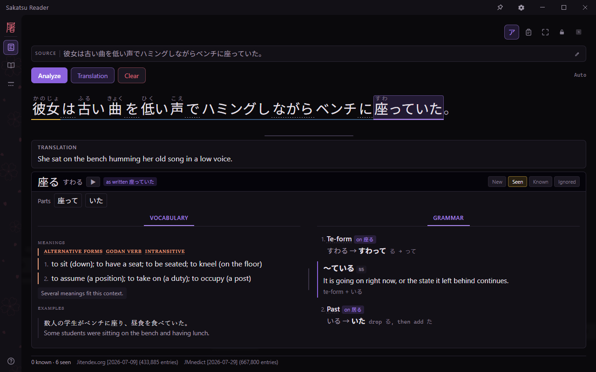
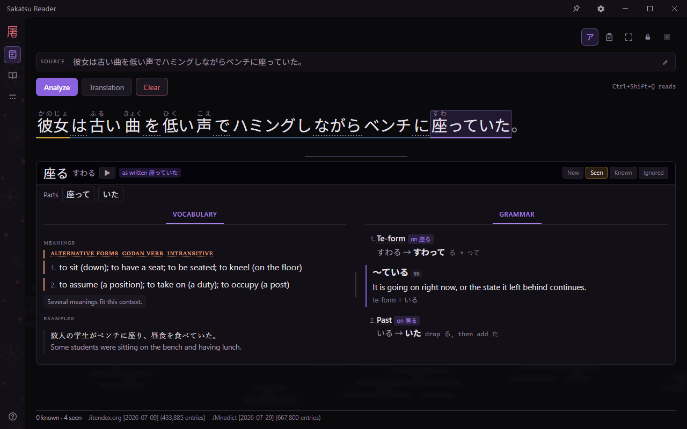
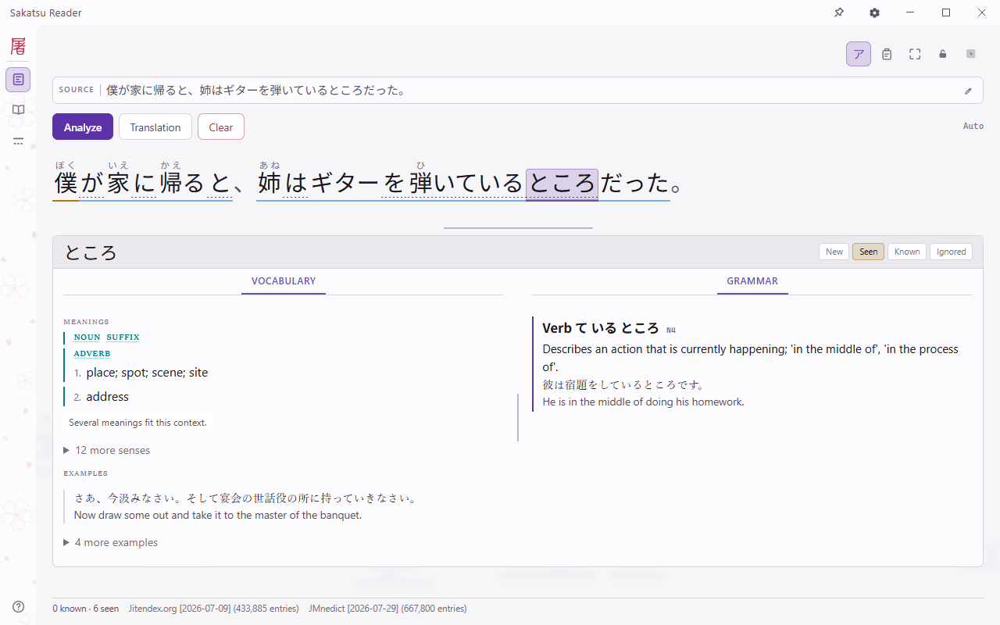
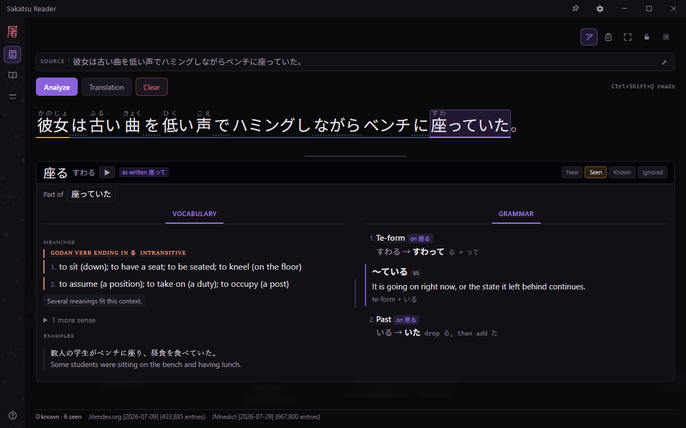
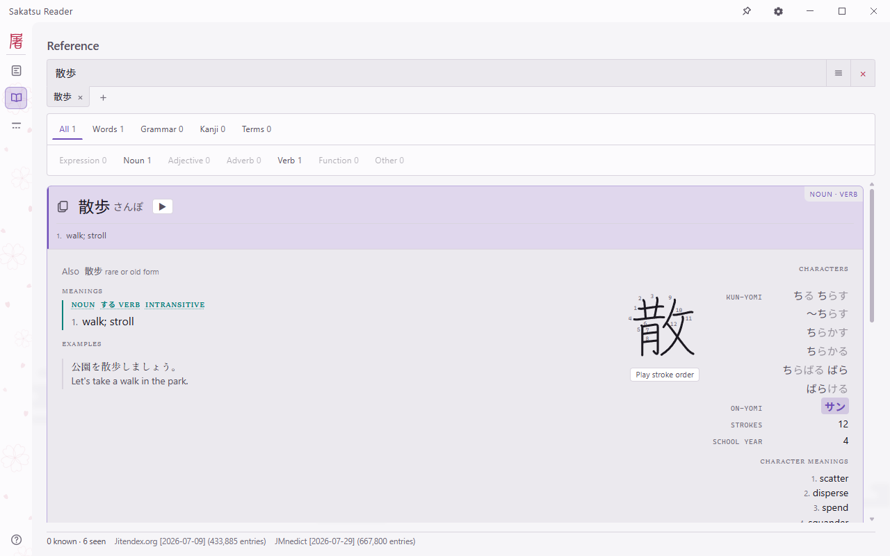
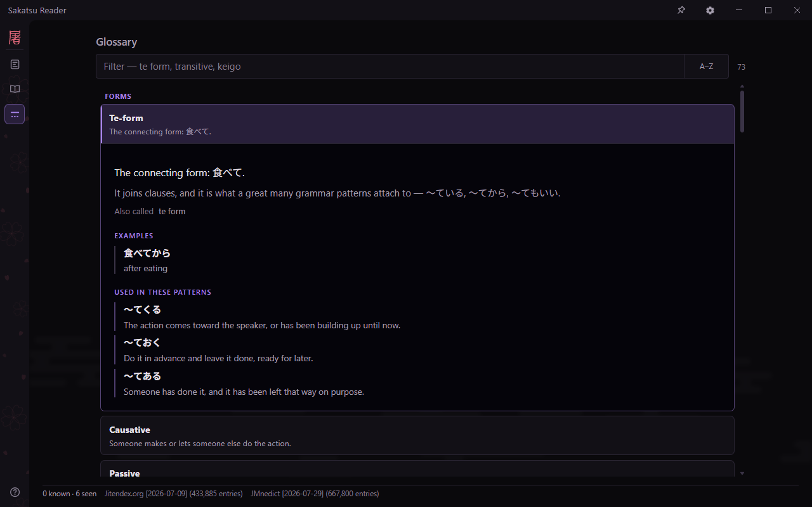
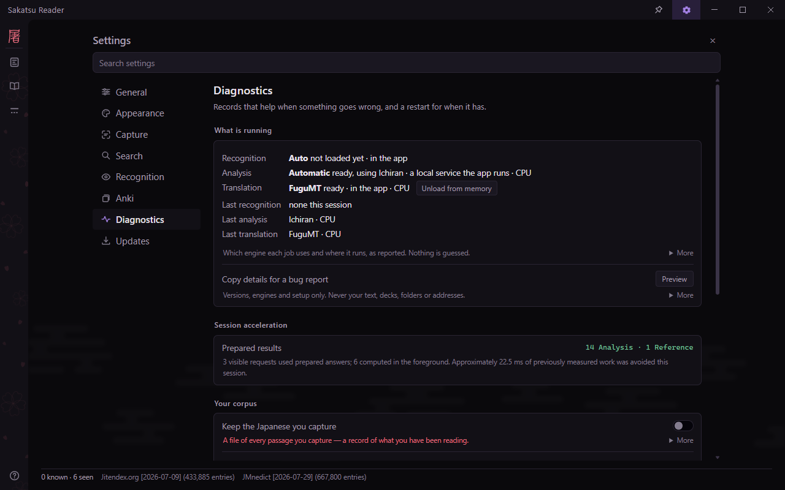
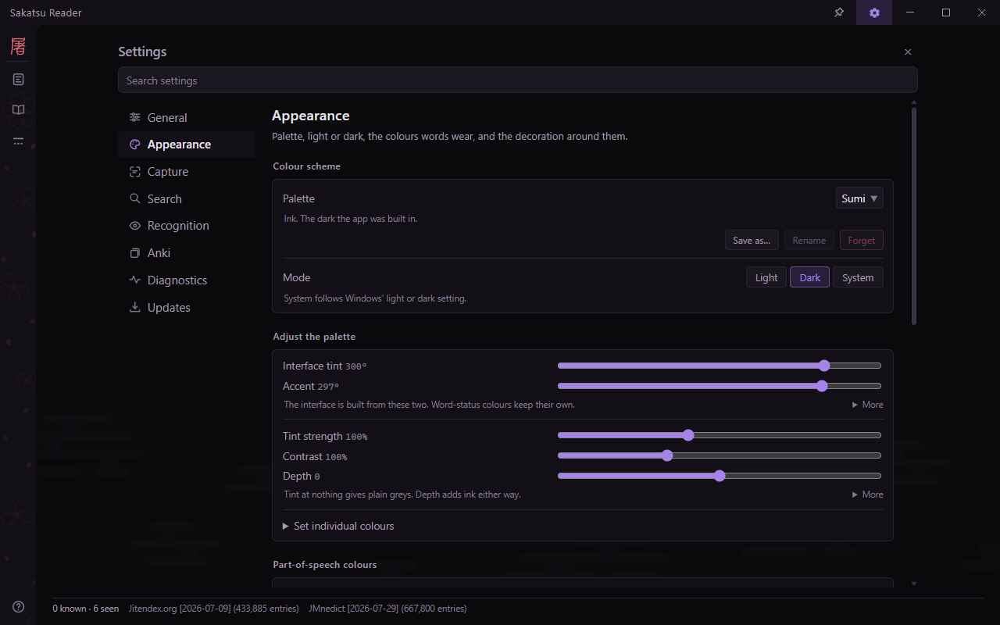
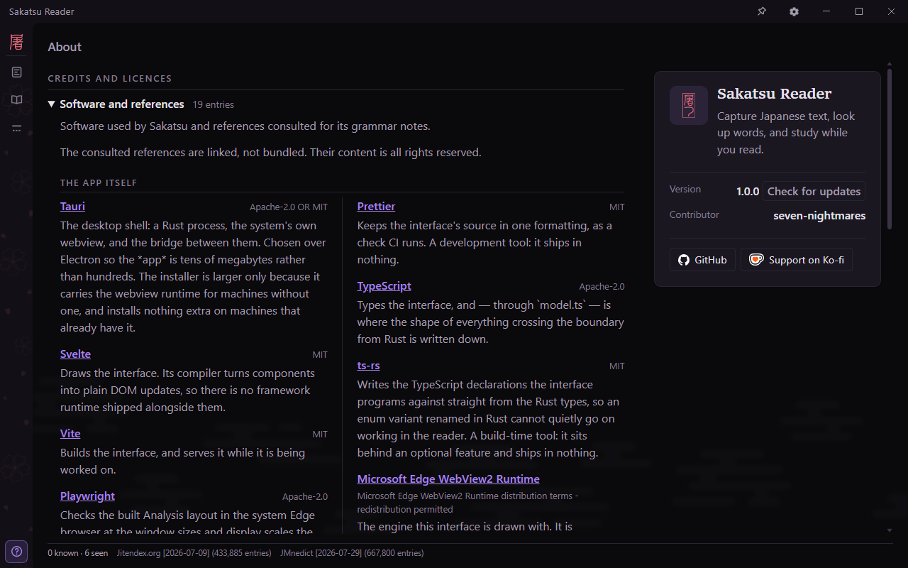
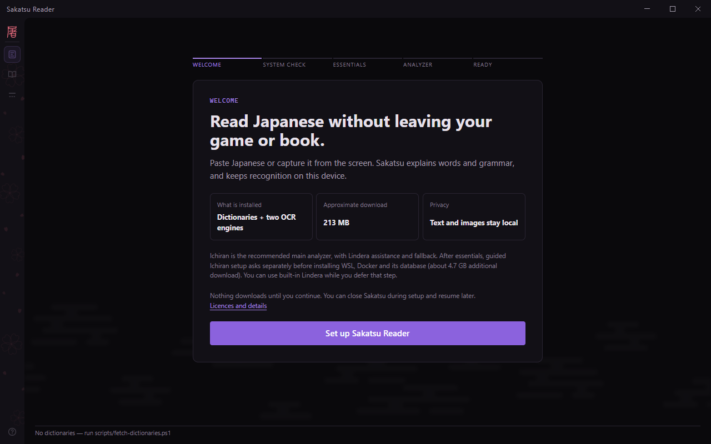

# Sakatsu Reader

A desktop reading aid for Japanese study, built with Rust. Capture text from anywhere on your
screen, read with furigana, look up words, and explore meanings, conjugations, and grammar as
you go.


[Features](#features) · [Screenshots](#screenshots) · [Getting started](#getting-started) · [Models and data](#models-and-data) ·
[Troubleshooting](#troubleshooting) · [Development](./DEVELOPMENT.md) · [Licences](./LICENSING.md)

Sakatsu is for reading real Japanese: manga panels, game dialogue, web pages, anything on your
screen. It recognises the text, splits it into words, gives each its reading in context, its
dictionary meanings and its conjugation, and spots the grammar patterns in the sentence. Then it
lets you mark what you know, look anything up on purpose, hear it, and send it to Anki with the
sentence you met it in.

> [!NOTE]
> Recognition, analysis, dictionaries and translation run on your machine and work offline once
> they are set up. Models and dictionaries download after you review their size and licence.
> The app sends no analytics or crash reports. Update checks, word audio and a recognition
> endpoint on another computer use the network; [Troubleshooting](#troubleshooting) says what each sends.

> [!TIP]
> It works the moment it opens: a Japanese analyzer is built into the app, so pasted text can be
> read before anything has been installed.



<sub>Tatoeba sentence
[#90201](https://tatoeba.org/en/sentences/show/90201), CC BY 2.0 FR.</sub>

---

## Features

- **Capture from anywhere.** <kbd>Ctrl</kbd>+<kbd>Shift</kbd>+<kbd>Q</kbd> freezes the screen
  and lets you drag over the text. The clipboard button reads Japanese as you copy it, and
  pasting works too.
- **Recognition built for manga and games.** *Auto* combines PP-OCRv6's clean horizontal reads
  with manga-ocr for vertical text and difficult lines. A vision-language reader, PaddleOCR-VL
  (manga), is optional for machines with a graphics card.
- **Reading at a glance.** Furigana chosen from the context, word boundaries you can click, and
  each word coloured by your own status: new, seen, known or ignored.
- **Every word explained.** Senses from Jitendex and JMnedict, merged; example sentences; the
  reading the sentence actually uses; and conjugations unwound step by step (行こう is the
  volitional of 行く).
- **Grammar spotted in the sentence.** 66 curated points and 816 JLPT points, 457 of them
  matched automatically, each with an explanation, a JLPT level and a real example. The
  particles で and に are ranked by sense, with the reason shown.
- **Look things up on purpose.** One search box answers with words, grammar, kanji and terms
  together, in Japanese or English. Kanji details include stroke order and the reading a given
  word uses for each character.
- **Translation only when you ask.** A rough English gist from FuguMT, never shown
  automatically: the point is to read the Japanese first.
- **Study.** Send a word to Anki with its sentence and furigana, and hear it, from an offline
  pronunciation pack or on demand.
- **Two analyzers.** The built-in one (Lindera with UniDic) needs nothing. Ichiran, a richer
  analyzer, can be added through a guided setup and becomes the main one, with the built-in
  analyzer as its assistant and fallback.

## Screenshots

<table>
  <tr>
    <td width="50%"></td>
    <td width="50%"></td>
  </tr>
  <tr>
    <td><b>Reading.</b> Contextual furigana, dictionary meanings and examples, with conjugation explained beside the word.</td>
    <td><b>The light theme.</b> Grammar patterns appear alongside the selected word, here "in the middle of doing".</td>
  </tr>
  <tr>
    <td></td>
    <td></td>
  </tr>
  <tr>
    <td><b>Word parts.</b> Open a component for its own lookup and learning status, then return to the whole word.</td>
    <td><b>Reference.</b> Search words, grammar, kanji and terms; inspect readings and stroke order.</td>
  </tr>
  <tr>
    <td></td>
    <td></td>
  </tr>
  <tr>
    <td><b>Glossary.</b> Grammar terminology explained, with examples and links to related patterns.</td>
    <td><b>Diagnostics.</b> See which engines answered, what is loaded, and copy a report without your text or folders.</td>
  </tr>
  <tr>
    <td></td>
    <td></td>
  </tr>
  <tr>
    <td><b>Appearance.</b> Choose a theme and adjust the palette, sizing and decoration.</td>
    <td><b>About.</b> Project links and credits for the software, dictionaries and models.</td>
  </tr>
</table>

<sub>Example sentences from Tatoeba
[#90201](https://tatoeba.org/en/sentences/show/90201) and
[#10908925](https://tatoeba.org/en/sentences/show/10908925), CC BY 2.0 FR. Dictionary text and
its examples from [Jitendex](https://jitendex.org/), CC BY-SA 4.0, built on JMdict (EDRDG). Kanji
data from KANJIDIC2 (EDRDG), CC BY-SA 4.0, and stroke order from KanjiVG (Ulrich Apel),
CC BY-SA 3.0. See [LICENSING.md](./LICENSING.md).</sub>

## Getting started

**Requirements:** Windows 10 or 11, 64-bit. The installer includes the WebView2 runtime the
interface is drawn with, installs for the current user, and needs no administrator prompt.

There is no published release yet. Build the installer from source (the prerequisites are in
[DEVELOPMENT.md](./DEVELOPMENT.md#development)):

```powershell
npm --prefix ui ci
node scripts/stage-vc-runtime.mjs
cargo tauri build --bundles nsis   # → target/release/bundle/nsis
```

**First run.** Guided setup offers dictionaries, kanji details, particle data and both OCR
engines, with download sizes and licences shown first. It then offers Ichiran as the recommended
main analyzer, with Lindera providing assistance and fallback. Ichiran's WSL, Docker and database
installation requires separate consent; built-in Lindera remains available while you defer it.
Translation, offline pronunciation, frequency data and PaddleOCR-VL can be added later.



## Models and data

Nothing below is bundled. Each is fetched from a pinned version, checked against its size and
digest, and credited on the app's About page. [LICENSING.md](./LICENSING.md) has the full terms.

### Recognition

| Engine | Role | Licence | Setup |
|---|---|---|---|
| [PP-OCRv6 small](https://github.com/PaddlePaddle/PaddleOCR) | fast horizontal text and line detection | Apache-2.0 | essential |
| [manga-ocr](https://github.com/kha-white/manga-ocr) | vertical and stylised text | Apache-2.0 | essential |
| [PaddleOCR-VL for Manga](https://huggingface.co/adambarbato/PaddleOCR-VL-For-Manga-GGUF) | most accurate; needs a graphics card | Apache-2.0, with [llama.cpp](https://github.com/ggml-org/llama.cpp) (MIT) | optional |

### Analysis

| Analyzer | Notes | Licence | Setup |
|---|---|---|---|
| [Lindera](https://github.com/lindera/lindera) with UniDic | built into the app | MIT; UniDic BSD, GPL or LGPL | none |
| [Ichiran](https://github.com/tshatrov/ichiran) | full conjugation chains and compounds; runs in WSL | MIT | recommended, guided |

### Dictionaries and knowledge

| Data | Used for | Licence | Setup |
|---|---|---|---|
| [Jitendex](https://jitendex.org) | word meanings and examples | CC BY-SA 4.0 | essential |
| [JMnedict](https://www.edrdg.org/enamdict/enamdict_doc.html) | names | CC BY-SA 4.0 | essential |
| [KANJIDIC2](https://www.edrdg.org/wiki/index.php/KANJIDIC_Project) | kanji readings and meanings | CC BY-SA 4.0 | essential |
| [KanjiVG](https://kanjivg.tagaini.net) | stroke order | CC BY-SA 3.0 | essential |
| [KRADFILE](https://www.edrdg.org/krad/kradinf.html) | visual components | EDRDG licence | essential |
| [Japanese WordNet](https://bond-lab.github.io/wnja/) | particle senses | BSD-like | essential |
| [Tofugu pronunciation audio](https://github.com/tofugu/japanese-vocabulary-pronunciation-audio) | offline word audio | CC BY-SA 4.0 | optional |
| [JPDB](https://jpdb.io) and [BCCWJ](https://clrd.ninjal.ac.jp/bccwj/en/) frequency lists | word frequency | per source | optional |

### Translation and grammar

| Source | Used for | Licence |
|---|---|---|
| [FuguMT](https://huggingface.co/staka/fugumt-ja-en) | Japanese → English gist (optional) | CC BY-SA 4.0 |
| [hanabira.org](https://github.com/tristcoil/hanabira.org-japanese-content) | the 816 JLPT grammar points | CC0 |
| [Tatoeba](https://tatoeba.org) | example sentences in the grammar notes | CC BY 2.0 FR |

## Troubleshooting

- **Something says it is missing or damaged.** Open **Settings → Installation** and choose
  **Repair installation**, or **Resume setup** if setup was paused.
- **Logs** are in `%APPDATA%\com.sakatsu.app\logs`. Word status and settings live in
  `%APPDATA%\com.sakatsu.app\store` as plain JSON. If the store cannot be opened, the app still
  runs and says so in a banner.
- **Choosing the analyzer.** It is automatic: Ichiran if it answers, the built-in analyzer
  otherwise. Force one with `SAKATSU_ANALYZER=ichiran` or `SAKATSU_ANALYZER=lindera`, and point
  at a non-default Ichiran with `SAKATSU_ICHIRAN_CMD`.
- **What reaches the network.** Downloads during setup, after you agree to each. Word audio: a
  word shown with a ▶ button that the offline pronunciation pack does not have is checked with
  JapanesePod101 once, which sends the word and its reading, and pressing ▶ fetches its recording.
  A recognition endpoint you set receives each captured image, so one on another computer means
  the image leaves this one. Anki is reached only on this computer. Update checks contact the
  release service at most once a day when enabled, without captured text. Turn them off in
  Settings > Updates. Downloading and installing an app update each require your choice.

## Development

Rust 1.92+, Node 20.19+ or 22.12+, and the Tauri CLI. On Windows, stage the C++ runtime once with
`node scripts/stage-vc-runtime.mjs`, then:

```powershell
npm --prefix ui ci
cargo tauri dev                    # run the app
cargo test --workspace             # and the rest of the checks CI runs
```

[DEVELOPMENT.md](./DEVELOPMENT.md) has the full set of checks, what each part of the app does and
why, and the measurements behind its choices. project notes holds the architecture and
the reasoning.

## Licence

Copyright 2026 the Sakatsu contributors.

Sakatsu's own code is licensed under the [GNU General Public License, version 3 only](./LICENSE)
(`GPL-3.0-only`). You may use, modify and redistribute it, including commercially, under those
terms. Distributed versions must meet the GPL's source-code and licensing requirements. There is
no warranty. Unless explicitly agreed otherwise, contributions submitted for inclusion are
provided under the same licence.

Sakatsu is a clean-room implementation. It was designed against the behaviour of japReader, which
is GPL-3.0, and contains none of its source.

The dictionaries and models it downloads are not part of this repository. Each keeps its own
licence and attribution terms, set out in [LICENSING.md](./LICENSING.md). The licence texts of the
libraries compiled into the app are in [THIRD-PARTY-NOTICES.txt](./src-tauri/THIRD-PARTY-NOTICES.txt).

### Included resources and dictionary updates

The installer includes the tested dictionaries, kanji resources and essential OCR models.
Setup installs these locally; Ichiran and optional features have separate setup steps.
Use **Settings > Search > Dictionaries** to check for updates or import a downloaded dictionary.
Updates ask before downloading by default. Automatic dictionary updates are optional.
